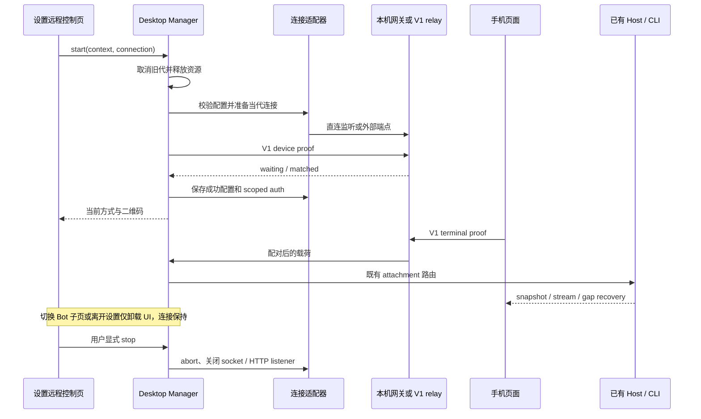

# V1 远程控制连接方式

## 产品规则

设置 → 远程控制中的手机连接卡片提供直接访问、自建 relay、官方 relay 三种方式。三者均使用 V1 `auth_init → auth_challenge → auth_response` 的 HMAC 配对，共用现有手机页面、Desktop transport 和窗口 Host attachment。官方预设为 `wss://zcode.z.ai/ws` 与 `https://zcode.z.ai/remote/v4`，仅在用户选择后连接；不接入 OAuth、V2 注册或云端设备发现。官方入口的 `app_version` 是网页分流参数，传入 3.16 会选中登录页面；官方模式省略这个可选参数以进入当前公开的 V1 页面。transport 和 bootstrap 继续报告真实桌面版本。

首次打开只读取状态和连接配置，点击“开启远程控制”才连接。默认直接访问；已有环境变量成对配置时默认自建 relay。成功开启后保存配置，重新打开显示当前运行方式；运行时折叠配置并显示当前方式，留出二维码空间；修改配置需要先停止。离开设置或切换到 Bot 子页保留连接，“停止”释放连接及监听端口。刷新配对沿用当前连接方式并废弃旧配对材料。

直接访问面向局域网 HTTP 和 nginx 转发。根地址跳转到 `/remote/`；打开完整配对链接直接连接，打开裸地址显示配对链接输入页。每个窗口启动独立 HTTP/WS 网关，默认监听 `0.0.0.0` 的可用端口，自动选择本机非回环 IPv4 生成链接；可填写监听地址、固定端口及浏览器访问地址。无可用 IPv4 时要求填写地址，不能生成手机不可达的 localhost 链接。反向代理需转发 `/remote/` 静态页面和 `/ws` WebSocket；公网使用 HTTPS/WSS。网关只持有当次随机配对材料，直接访问停止或重启后旧链接失效。

自建模式填写 V1 relay 的 WebSocket 地址及手机页面地址；页面可与 relay 分开部署。二维码可增加 `relay` 参数，当前 Web 客户端优先使用该参数，旧二维码继续从页面 origin 推导 `/ws`。HTTPS 页面不能使用 WS；地址拒绝 URL 用户信息、片段及非 HTTP/WS 协议。旧官方页面同源推导行为保持兼容。

手机页面随 Desktop 产物打包；开发时亦可单独构建。普通 HTTP 的浏览器通过已有密码库完成 HMAC/SHA-256，通过共享 UUID 工具生成草稿、Hook 和文档面板标识，文档指纹与面板状态键也使用同一 SHA-256 兼容实现，不依赖仅安全上下文提供的 API。

官方旧 V1 页仍读取 bootstrap 的任务快照。仅官方模式运行时，Renderer 从已有 WindowController 列表 registry 读取当前窗口工作区的 timeline、pinned、archived 三组投影，合并完整结果后经 platform IPC 交给 Main 的旧协议输出。Main 只保留可丢弃的展示投影；任务成员、标题和活动事实仍由 Host / CLI 管理。停止、切换模式或窗口作用域变化使在途读取失效，远端任务保留 workspaceIdentity 和当前 remoteSessionId，未完成的分组读取不发布部分列表。

## 设置页与导航

桌面侧统一配置页为“设置 → 远程控制”。详情页并列展示“手机连接”和“Bot Channels”卡片；较窄窗口改为纵向排列。主工作区侧栏底部提供远控快捷按钮，先设置 remoteControl section intent，再调用既有打开设置动作；设置侧栏的 back 模式不重复提供入口。快捷按钮不打开独立配置弹窗、不启动连接。底部保留个人菜单和设置按钮，默认名称显示本地用户。布局与入口验收见[设置页布局规格](../spec/settings-visual-polish.md)。

手机卡片保留三种 V1 连接方式、显式开启、状态、停止、复制链接和重新配对。未开启时仅展示配置和开启动作，运行后展示二维码与连接操作。重新配对需确认旧链接失效，并沿用当前运行连接的完整工作区目标，不能混入最近浏览的另一个工作区身份。导航返回、切换设置分区和关闭设置仅卸载 UI，不调用 stop。

Bot 卡片的渠道入口和“管理机器人”在当前设置分区内打开管理子页，使用设置面包屑返回卡片页。复用现有 Bot 配置与注册流程，服务始终由本机 Host 提供；打开管理页不会主动启动第三方登录。渠道入口可按既有规则选择已有 Bot 或创建关闭态草稿。

设置导航沿用 SettingsPage 的 section intent 和上次分区偏好。该分区只在 Desktop 且远控功能可用时显示。手机目标沿用最近激活工作区的 path、identity 和当前仍存活的 remoteSessionId；设置 tab 本身不作为 workspace。没有工作区时禁止开启，Bot 管理仍可使用；远端会话已失效时不透传旧 session，手机继续沿用现有离线工作区展示；已有运行连接仍允许复制、重新配对与停止。

## 所有者与事件顺序

| 状态                          | 唯一所有者                                    | 其他层                                                      |
| ----------------------------- | --------------------------------------------- | ----------------------------------------------------------- |
| 设置分区 / Bot 子页           | SettingsPage / 远控页局部导航                 | 不持久化第二份连接或 Bot 事实                               |
| Bot 配置与运行状态            | 本机 Host 的 botsService                      | 设置页只复用已有管理组件                                    |
| 连接设置                      | Desktop Main 的 SettingService                | UI 只持有草稿，通过 platform 请求                           |
| 窗口连接代次、网关生命周期    | WebRemoteControlManager / AbortController     | stop、失败、窗口关闭均释放                                  |
| V1 配对凭据                   | CredentialService（外部 relay）或内存（直连） | 按规范化端点和窗口隔离；设置文件不保存秘密                  |
| Socket、心跳和重连            | 现有 device/terminal transport                | 网关只鉴权与转发                                            |
| 任务、输入、快照、owner/lease | 现有 Host / CLI runtime                       | 手机保持 web-remote-replayable；桌面保持 desktop-continuous |



启动恢复记录原子保存目标与当时的连接配置，避免多窗口交错保存后用另一种连接方式恢复旧目标。异步准备、凭据写入和注册回调均检查代次。迟到结果必须释放自己的资源，不能关闭新代连接。直连网关仅接受预置设备身份，禁止远程注册；device 连接限本机回环，terminal 通过一次性 nonce 与常量时间 proof 校验，错误连接和超时握手关闭。保留帧大小及发送背压上限。多窗口不复用同一个 SID。

外部 relay 的新凭据记录将 SID 与 passHash 一起存入 CredentialService，按端点及窗口构造 key。旧记录缺少端点归属，保留原记录、不推断迁移，新入口首次生成新配对。环境变量仅作为无已存配置时的自建默认值，显式选择其他方式优先。

## 验收用例与覆盖矩阵

| ID    | 设置、动作                                                                  | 必须断言                                                              | 验证层                  |
| ----- | --------------------------------------------------------------------------- | --------------------------------------------------------------------- | ----------------------- |
| V1-01 | 未配置打开设置远程控制页，选择三种方式                                      | 不自动联网；字段随选择变化；开启动作显式                              | UI E2E                  |
| V1-02 | 直连 loopback 测试端口，以解析到 loopback 的非 localhost 域名访问，手机配对 | 静态资源可读；正常 proof 成功；双向消息；未鉴权数据拒绝               | 网关集成、Desktop E2E   |
| V1-03 | 错 proof、重复 nonce、远程 device 注册、超限输入                            | 不转发，连接关闭                                                      | 网关集成                |
| V1-04 | 停止、刷新、取消启动、多窗口                                                | 监听释放；旧链接失效；另一窗口及新代不受影响                          | manager / provider 集成 |
| V1-05 | relay A/B、窗口 A/B、直连切换                                               | 凭据隔离；配置保存失败释放当代资源；旧存储未改写                      | adapter / manager       |
| V1-06 | 页面与 relay 异源、旧 QR、错误协议                                          | 新 relay 参数生效；旧 origin fallback；拒绝 HTTPS→WS                  | shared / Web            |
| V1-07 | HTTP 无 subtle/randomUUID                                                   | HMAC 与标准向量一致；新建草稿及附件摘要可用                           | Web / UI 单测及浏览器   |
| V1-08 | 自建 V1 fixture 与真实官方 V1                                               | 无账号正常配对和双向消息；失败显示连接错误                            | 集成 / 独立协议探测     |
| V1-09 | 桌面会话在手机恢复                                                          | 既有 owner、workspaceIdentity、bridge generation、replayable 测试通过 | 既有定向回归            |
| V1-10 | Desktop 构建与反向代理路径                                                  | out/web-remote 存在；/remote/ 引用有效；停止后资源不可访问            | build / HTTP            |
| V1-11 | 设置入口、首页快捷按钮、手机与 Bot 卡片、Bot 子页返回                       | 首页直达设置且不连接；页内导航不出现配置弹窗；Bot 使用本机服务        | UI 单测、Desktop E2E    |
| V1-12 | 进入 / 离开设置、同路径远端、失效 session、无工作区                         | 不自动连接或停止；identity 不丢失；失效 session 不透传；Bot 仍可管理  | UI 单测、Desktop E2E    |

V1-08 另验证官方旧页可列出并打开预置的桌面历史任务，且列表更新只来自现有 Controller。

V2/OAuth 用例不进入此功能矩阵；真实公网部署、手机硬件与不同网络运营商的可达性另行验收。候选 E2E 放入 manual-review/pending，不自动提升为正式套件。

候选交互用例：`packages/desktop/test/e2e/conversation-session/manual-review/pending/web-remote-v1-connections.test.ts`。隔离 HOME、合成 relay、真实桌面与浏览器；不依赖真实模型请求。

## 使用方式

打开桌面设置 → 远程控制，选择连接方式并点击开启。直接访问可使用生成的完整链接，或先打开 `http://电脑地址:端口/` 再粘贴配对链接。手机与电脑需处于可互访的网络。默认端口自动分配，nginx 转发时填写固定端口。

同机 nginx 转发示例：桌面监听 `127.0.0.1:8080`，访问地址填写 nginx 的 HTTP/HTTPS 地址。保持 `/remote/` 与 `/ws` 两个路径：

```nginx
location = / {
    return 302 /remote/;
}
location /remote {
    proxy_pass http://127.0.0.1:8080;
    proxy_set_header Host $host;
    # 配对参数在 URL 中；此路径不记录请求查询串。
    access_log off;
}
location = /ws {
    proxy_pass http://127.0.0.1:8080;
    proxy_http_version 1.1;
    proxy_set_header Upgrade $http_upgrade;
    proxy_set_header Connection "upgrade";
    proxy_read_timeout 75s;
}
```

自建模式使用兼容本项目 V1 合同的 relay：支持 `device_register_init`、HMAC challenge/proof、`waiting/matched`、心跳查询和双向 `data` 转发。手机页面可单独部署，构建命令为 `pnpm --filter @zcode/web exec vite build --base=/remote/`，输出在 `packages/web/dist/`。在手机连接卡片中分别填写 relay WS 地址和页面 HTTP 地址；HTTPS 页面需配套 WSS。本文提供客户端接入和静态页构建，不自动安装或部署 relay 服务。

官方模式直接选择官方 V1 preset。官方服务的停用或协议变化显示为连接错误，不切换到账号登录。

合并 3.16.2 后，CF-01 Bot 连接错误候选经设置卡片进入内嵌管理页，在页面保持打开时验证错误与绑定状态。该用例不启动手机 relay，也不调用真实第三方渠道。
