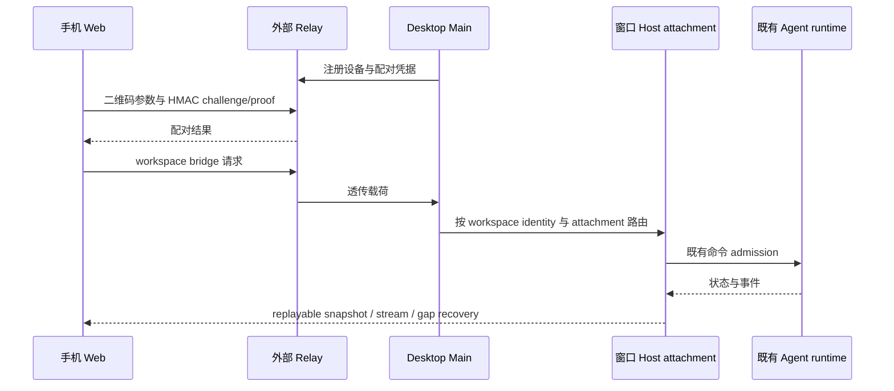

# Web 远程控制与 V1 连接

手机浏览器通过直连网关、自建 V1 relay 或官方 V1 relay 接入桌面窗口已有的 Host attachment，复用同一 workspace 服务和 Agent runtime。手机可以浏览项目与任务、发送输入、处理会话交互，并在连接恢复后同步任务状态。

## 所有者与交付边界



- CLI/runtime `CommandInbox` 串行接纳已接受输入，Host owner/lease 决定路由。
- Desktop 使用 `desktop-continuous`；手机使用 `web-remote-replayable`，通过 snapshot、序号和 gap 恢复同步。
- 手机选中的工作区与任务独立于桌面 tab。手机操作不另起 Agent、Local Host 或远程会话。
- Relay 与 Main 负责配对、心跳、透传和 attachment 调度；任务队列、快照与执行状态由既有业务 owner 持有。

## 配对与端点

当前入口使用 passHash HMAC QR 配对。二维码由 `buildWebRemoteControlExternalQrUrl` 生成，`parseWebRemoteControlExternalQrParams` 校验 `sid`、`hash` 与数值 `t`；其余元数据按共享契约处理。二维码及其完整链接属于配对凭据，不写入日志或公开示例。

Desktop 的 `webRemoteControlRelayAuthProvider` 与 Web adapter 使用同一证明串：

```text
HMAC-SHA256(passHash, nonce + "|" + role + "|" + deviceSid)
```

连接方式在设置 → 远程控制的手机连接卡片中选择。Bot Channels 管理在同一分区内打开子页，使用面包屑返回；离开设置保留运行连接，只有显式停止才释放。默认直连，通过桌面提供的 HTTP 页面接入；自建模式配置 WS 与手机页面；官方模式显式使用 V1 preset。完整配置、配对和 nginx 转发见 [V1 连接方式](v1-connection-modes.md)。

旧 `ZCODE_WEB_REMOTE_CONTROL_RELAY_WS_URL` 和 `ZCODE_WEB_REMOTE_CONTROL_URL` 作为尚未保存连接配置时的自建默认值。`pnpm dev:web-remote-control` 保留自建 relay 联调入口；普通桌面开发会构建配套手机页面。

## Workspace bridge 与恢复

手机解析已配对桌面窗口发布的 workspace 目录，按 `workspaceIdentity?.trim() || workspacePath` 选择目标；远端请求同时携带 remoteSessionId。workspacePath 继续用于文件操作、cwd、Git 与路径展示。

切换 workspace 时建立新的 bridge generation。旧请求、旧回包与旧订阅不能把已切换的页面恢复到过时代次。断线后重新同步现有 attachment，服务恢复资格由实际连接状态与 generation 决定。

3.16 的 task-view publisher 按已接受版本发布任务视图；版本接受回调和 bridge recovery 使用同一恢复流程。任务输入仍经既有 admission owner，Renderer 只保留草稿和 pending optimistic overlay。

窄屏使用首页与聊天两页布局。首页展示项目和任务；点击任务后进入聊天，返回首页保留任务定位。宽屏复用侧栏布局。手机主题由浏览器本地偏好管理。

## 服务与权限

- 工作区服务来自桌面已有 attachment；远程文件、Git 与执行继续发生在目标 Source。
- 手机不提供新建 SSH/WSL/Docker 连接或管理其他桌面窗口的隐式权限。
- 来源、session、owner/lease、bridge generation 与能力校验在原有边界执行。
- MCP Apps、Browser Use 与通用工具沿目标 workspace 的既有服务合同工作；手机页面不直接访问 Desktop 原生实现。

## 代码与验证入口

- 共享合同与二维码：`packages/shared/src/web-remote-control.ts`。
- Relay 端点：`packages/shared/src/zcodeEndpoint.ts`。
- Desktop HMAC：`packages/desktop/src/main/web-remote-relay/`。
- Web transport 与 requester：`packages/web/src/web-remote-control/adapters/`。
- Web 入口：`packages/web/src/main.tsx`。
- 任务实时同步、版本接受和 bridge/frame 恢复测试位于 `packages/web/test/`。

联调应覆盖配对、错误凭据、掉线恢复、workspace 换代、帧序号缺口，以及同一任务桌面 continuous 与手机 replayable 并存。单元测试通过记录与真实 relay/手机验收分别报告。

<!-- 上游把本架构重写为 Relay V2（账号 JWT 注册设备 + 一次性 token + 手机 OAuth 登录门禁，属 OAuth/官方端点净化域）；OpenZWork 保留本地 HMAC 配对变体（adapters/authProvider、directGateway），整段保持我方版本，不随上游引入 V2/OSS 网关部署链路 -->
